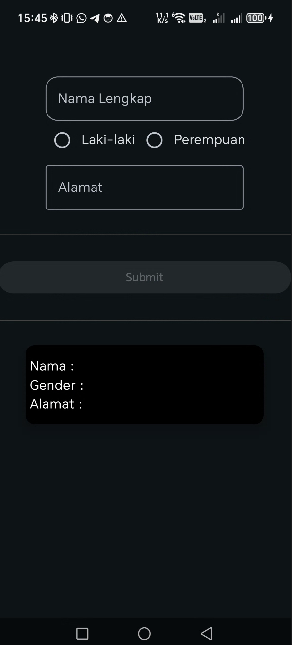
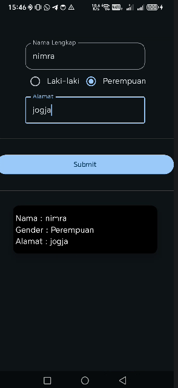

# QuestUserInput_0146

A small Jetpack Compose app with a form. You type your name, pick a gender and type your address. After you press Submit, the result shows in the card below.

## Output
 

## Files
- Act4.kt: the form screen (FormDataDir)
- MainActivity.kt: shows the form inside a Scaffold
- res/values: the strings, colors and dimens used by the form

The Submit button only works after the address is filled in.

Written following the practicum code from class.